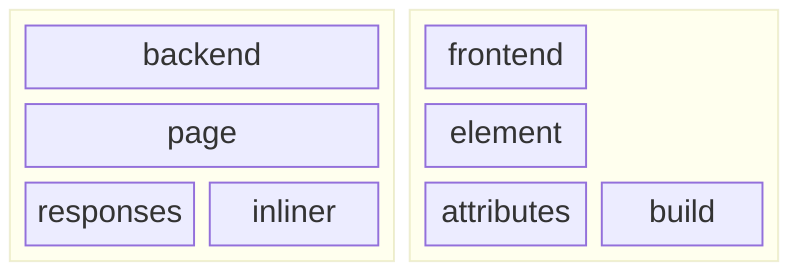

# `@onlyweb` tutorial

> [!TIP]
> When in doubt, everything in the framework has JSDoc annotations - just look
> at the source!

## concepts

The **onlyweb framework** is split into two main environments: the backend and
the frontend. These environments have similar, complementary APIs that are
designed to work together.

### backend

The backend server serves content via Deno. Key concepts:

1. **Page**: encapsulates a set of possible responses to an endpoint and selects
   one based on context. The **Page** also manages the **Inliner**.
2. **Response**: an object that represents how the Deno HTTP web server will
   respond to a given Request.
   [Learn more about HTTP here.](https://developer.mozilla.org/en-US/docs/Web/HTTP)
3. **Inliner**: _inlines_ content into a **Response**, building the static
   content you wish to respond with just in time.

### frontend

The frontend renders content in the browser via WebComponents. Key concepts:

1. **Element**: an HTML tag representing some meaningful section or component of
   your application. Each custom **Element** is basically like a little, nested
   website.
   [Learn more about HTML Elements here](https://developer.mozilla.org/en-US/docs/Web/HTML/Element).
2. **Attribute**: a property of an **Element** that can be set and read.
   Attributes are used to pass data to **Elements**.
   [Learn more about HTML Attributes here](https://developer.mozilla.org/en-US/docs/Web/HTML/Attributes).
3. **Build**: the process of creating an **Element** from a set of
   **Attributes**. This is where you define the structure of your **Element**.
