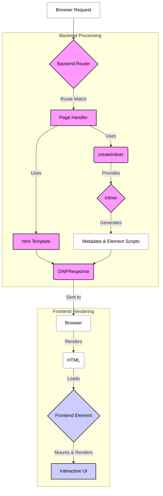

# `@onlyweb` Tutorial

Welcome to the OnlyWeb framework! This tutorial will guide you through the basic concepts of building a web application using its backend and frontend packages.

> [!TIP]
> When in doubt, everything in the framework has JSDoc annotations. The source code is your friend! You can also refer to the JSR documentation linked in the package READMEs:
> *   [`@onlyweb/backend`](../../backend/)
> *   [`@onlyweb/frontend`](../../frontend/)
> *   [`@onlyweb/shared`](../../shared/)

## Core Concepts

The **OnlyWeb framework** is split into two main environments that work together:

1.  `@onlyweb/backend`: Runs on the server (using Deno) to handle requests and generate HTML pages.
2.  `@onlyweb/frontend`: Runs in the browser to create interactive custom elements (Web Components).
3.  `@onlyweb/shared`: Contains utilities usable in both environments (logging, HTML helpers, etc.).

---

### Backend (`@onlyweb/backend`)

The backend server receives HTTP requests, processes them, and sends back HTML responses. Key concepts:

1.  **Page Registration (`registerPage`)**: This function maps a URL route (like `/` or `/users`) to a specific handler function. You define how the server should respond when a request matches that route. You can also specify browser requirements here.
    *   See: `backend/resource/page/register.ts`
2.  **Request (`OWFRequest`)**: An object representing the incoming HTTP request, containing details like the URL, headers, method, and detected language.
    *   See: `backend/resource/request/types.ts`
3.  **Response (`OWFResponse`)**: An object representing the outgoing HTTP response. You typically create this using the backend's `html` tagged template literal. It contains the status code, headers, and the HTML body.
    *   See: `backend/resource/response/types.ts`
    *   See: `backend/resource/response/template.ts`
4.  **Inliner (`createInliner`)**: A powerful utility created per-request. It helps embed dynamic content into your static HTML response *just in time*. Its main uses include:
    *   Generating `<meta>` tags (title, description).
    *   Injecting `<script>` tags to load frontend element code.
    *   Accessing localized messages based on the request language.
    *   See: `backend/resource/page/createInliner.ts`
5.  **Server Start (`start`)**: The function that boots up the Deno HTTP server, making it listen for incoming requests and route them to your registered pages.
    *   See: `backend/server/start.ts`

---

### Frontend (`@onlyweb/frontend`)

The frontend code runs in the user's browser, enhancing the HTML sent by the backend with interactive components. Key concepts:

1.  **Element Registration (`registerElement`)**: This function defines a custom HTML tag (like `<copy-code>`) and links it to your component's logic (attributes, rendering, lifecycle).
    *   See: `frontend/element/register.ts`
2.  **Custom Element (`OWFElement`)**: The base class your frontend components extend from. It provides lifecycle methods (`mount`, `render`), attribute handling, and automatic event listener cleanup.
    *   See: `frontend/element/element.ts`
3.  **Attributes**: Defined during element registration, these are the HTML attributes your custom element observes. Changes to these attributes automatically trigger a re-render. They are the primary way to pass data from the server (or parent elements) into your component. You access their current, typed values via `this.buildAttributes`.
    *   Learn more about HTML Attributes.
4.  **Render**: A required function in your element definition. It defines the internal structure (Shadow DOM) and styling of your element using the frontend's `html` tagged template literal. It receives the current attribute values as an argument and runs whenever an observed attribute changes.
    *   See: `frontend/element/html.ts`
5.  **Mount**: An optional lifecycle function called once after the element is added to the page and its initial render is complete. It's the ideal place to add event listeners or perform initial setup that requires access to the element's rendered DOM.

---

This tutorial example (`main.js` and `copy-code.js`) demonstrates how these backend and frontend concepts work together to create a simple, interactive web page.

