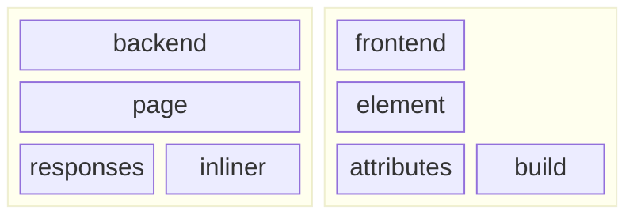

> [!TIP]
> When in doubt, everything in the framework has JSDoc annotations - just look
> at the source!

## concepts



The **onlyweb framework** is split into two main environments: the backend and
the frontend. These environments have similar, complementary APIs that are
designed to work together.

### backend

The backend server serves content via Deno. Key concepts:

1. **Page**: encapsulates a set of possible responses to an endpoint and selects
   one based on context. The **Page** also manages the **Inliner**.
2. **Response**: an object that represents how the Deno HTTP web server will
   respond to a given Request.
   [Learn more about HTTP here.](https://developer.mozilla.org/en-US/docs/Web/HTTP)
3. **Inliner**: _inlines_ content into a **Response**, building the static
   content you wish to respond with just in time.

### frontend

The frontend renders content in the browser via WebComponents. Key concepts:

1. **Element**: an HTML tag representing some meaningful section or component of
   your application. Each custom **Element** is basically like a little, nested
   website.
   [Learn more about HTML Elements here](https://developer.mozilla.org/en-US/docs/Web/HTML/Element).
2. **Attribute**: a property of an **Element** that can be set and read.
   Attributes are used to pass data to **Elements**.
   [Learn more about HTML Attributes here](https://developer.mozilla.org/en-US/docs/Web/HTML/Attributes).
3. **Build**: the process of creating an **Element** from a set of
   **Attributes**. This is where you define the structure of your **Element**.

This is abstract, so let's walk through a simple example to make things more
concrete.

### basic tutorial

1. Start by registering the main **Page** we're going to serve from the backend:

```js
import "https://raw.githubusercontent.com/daniellacosse-code/onlyweb.dev/main/bundles/$Backend.js";

$Backend.Page.Register("/", {
  handleRequest: async (request) =>
    $Backend.Page.Response.html`
    <body>
      <h1>Your search is: ${request.url.search}</h1>
    </body>
  `,
});
```

2. The default response has no metadata, so external sites won't know how to
   display it. Create an **Inliner** to add some:

```js
$Backend.Page.Register("/", {
  handleRequest: async (request) => {
    const inliner = await Backend.Page.Inliner(request, { messagesFolder: "" });

    return $Backend.Page.Response.html`
      <head>
        ${
      inliner.metadata({
        title: "what's my search?",
        description: "a simple page that shows the search query",
      })
    }
      </head>
      <body>
        <h1>Your search is: ${request.url.search}</h1>
      </body>
    `;
  },
});
```

3. Our page only works in English. Provide the **Inliner** with
   [a folder of translations like this one](../app/assets/messages/) so we can
   support those languages:

```js
$Backend.Page.Register("/", {
  handleRequest: async (request) => {
    const inliner = await Backend.Page.Inliner(
      request,
      { messagesFolder: "%path/to/messages/folder%" },
    );

    return $Backend.Page.Response.html`
      <head>
        ${
      inliner.metadata({
        title: inliner.message("what's my search?"),
        description: inliner.message(
          "a simple page that shows the search query",
        ),
      })
    }
      </head>
      <body>
        <h1>${inliner.message("Your search is:")} ${request.url.search}</h1>
      </body>
    `;
  },
});
```

4. We want to be able to easily copy our search string to the clipboard. We'll
   have to create a new frontend **Element** to do this. Here's that initial
   file.

```js
$Frontend.Element.Register("copy-code", {
  buildAttributes: { copied: Boolean, ["copy-message"]: String, code: String },
  // Note that the html template tag here is different than the Backends'
  handleBuild: ({ code, copied, ["copy-message"]: copyMessage }) =>
    $Frontend
      .Element.html`
    <style>
      div {
        display: relative;
      }
      code {
        font-family: monospace;
        font-size: 1rem;
        text-overflow: ellipsis;
      }
      div[popover] {
        display: absolute;
        top: 0;
        left: 0;
      }
    </style>
    <div>
      <code>${code}</code>
      <div popover>${copyMessage}</div>
    </div>
  `,
});
```

5. The onlyweb framework simply wraps the existing Event API to handle I/O. To
   do the copy, listen for a click event on mount:

```js
$Frontend.Element.Register("copy-code", {
  buildAttributes: { copied: Boolean, ["copy-message"]: String, code: String },
  handleMount: () => {
    this.addEventListener("click", () => {
      if (this.buildAttributes.copied) {
        return;
      }

      globalThis.navigator.clipboard.writeText(this.buildAttributes.code);

      this.querySelector("div[popover]").togglePopover();
      this.buildAttributes.copied = true;
    });
  },
  handleBuild: ({ code, copied, ["copy-message"]: copyMessage }) =>
    $Frontend
      .Element.html`
    <style>
      div {
        display: relative;
      }
      code {
        font-family: monospace;
        font-size: 1rem;
        text-overflow: ellipsis;
      }
      div[popover] {
        display: absolute;
        top: 0;
        left: 0;
      }
    </style>
    <div>
      <code>${code}</code>
      <div popover>${copyMessage}</div>
    </div>
  `,
});
```

6. Now to actually use our `<copy-code>` **Element** we must inline it into the
   **Page**. You do that like so:

```js
$Backend.Page.Register("/", {
  handleRequest: async (request) => {
    const inliner = await Backend.Page.Inliner(
      request,
      { messagesFolder: "%path/to/messages/folder%" },
    );

    return $Backend.Page.Response.html`
      <head>
        ${
      inliner.metadata({
        title: inliner.message("what's my search?"),
        description: inliner.message(
          "a simple page that shows the search query",
        ),
      })
    }
        ${inliner.elements("%path/to/element/copy-code.js%")}
      </head>
      <body>
        <h1>${inliner.message("Your search is:")} ${request.url.search}</h1>

        <copy-code code="${request.url.search}" copy-message="${
      inliner.message(
        "Copied!",
      )
    }"></copy-code>
      </body>
    `;
  },
});
```

7. HTML popovers aren't super supported yet, so let's indicate that in our
   pages' requirements:

```js
$Backend.Page.Register("/", {
  requirements: {
    engine: {
      Firefox: "125",
      Safari: "17.0",
    },
  },
  handleRequest: async (request) => {
    const inliner = await Backend.Page.Inliner(
      request,
      { messagesFolder: "%path/to/messages/folder%" },
    );

    return Backend.Page.Response.html`
      <head>
        ${
      inliner.metadata({
        title: inliner.message("what's my search?"),
        description: inliner.message(
          "a simple page that shows the search query",
        ),
      })
    }
        ${inliner.elements("%path/to/element/copy-code.js%")}
      </head>
      <body>
        <h1>${inliner.message("Your search is:")} ${request.url.search}</h1>

        <copy-code code="${request.url.search}" copy-message="${
      inliner.message(
        "Copied!",
      )
    }"></copy-code>
      </body>
    `;
  },
});
```

8. Finally, create a new file for your app's main entrypoint. Import your page
   and start the backend!

```js
import "https://raw.githubusercontent.com/daniellacosse-code/onlyweb.dev/main/bundles/$Backend.js";

import "%path/to/page.js%";

$Backend.start();
```